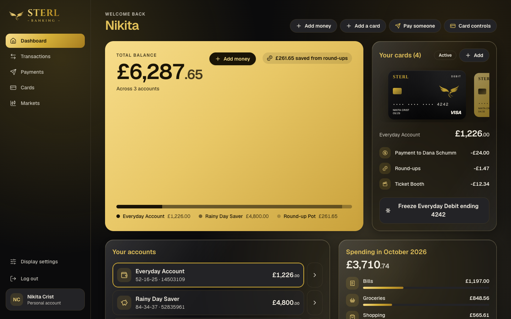
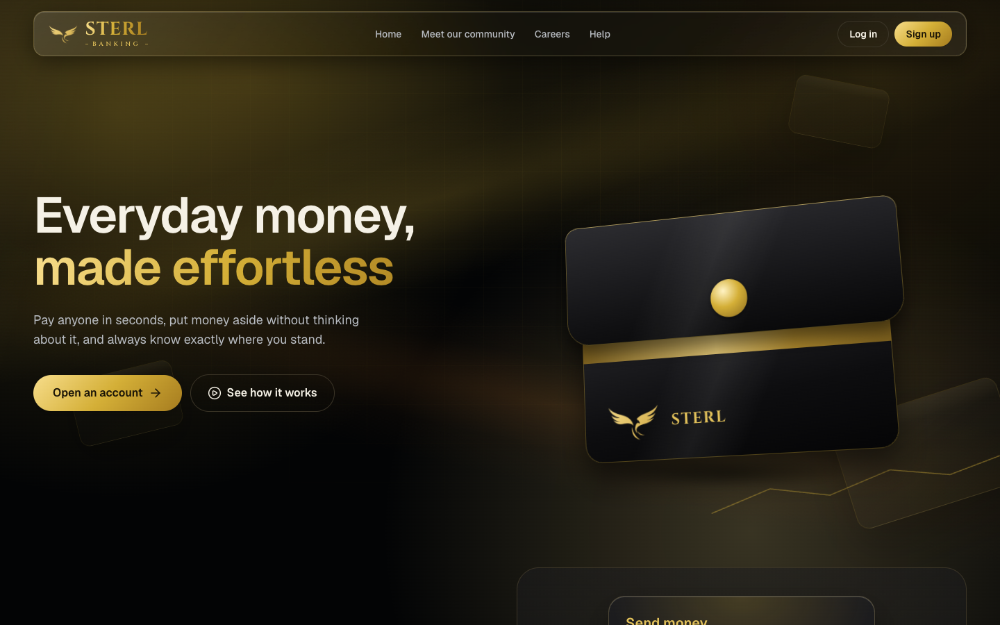
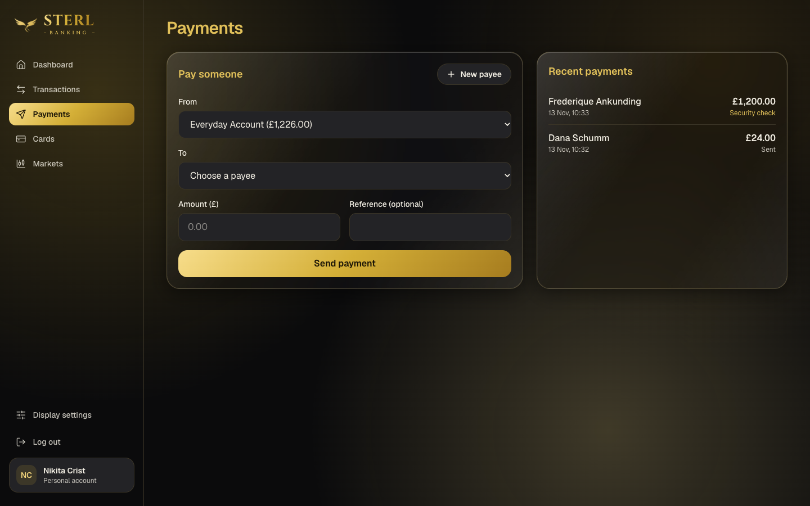
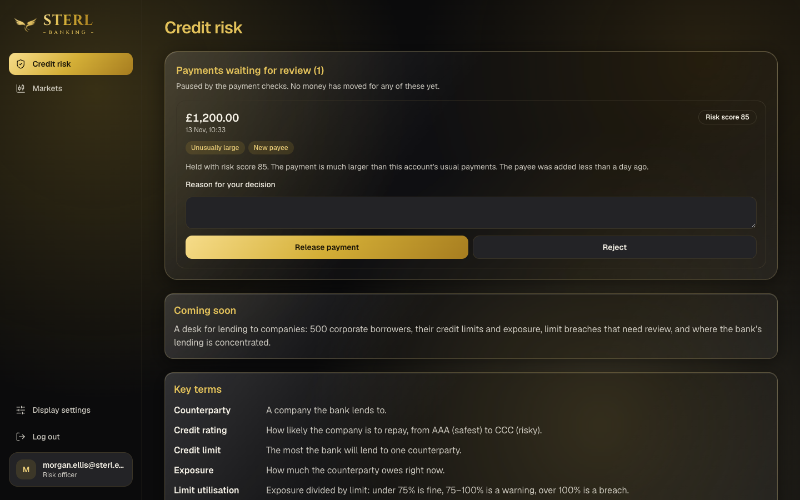
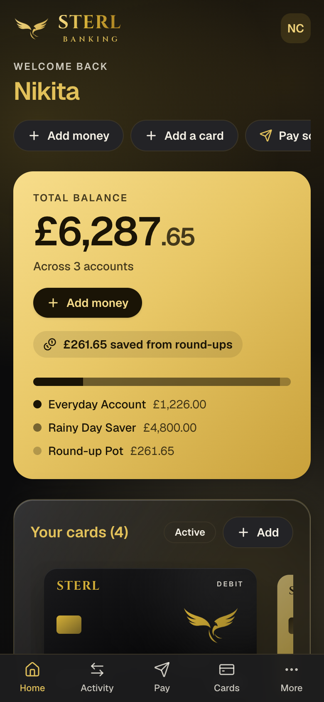
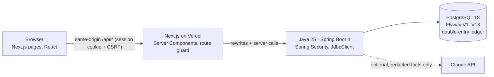

# Sterl

[](https://github.com/mehak-javed/Sterl-bank/actions/workflows/ci.yml)
[](https://github.com/mehak-javed/Sterl-bank/actions/workflows/api.yml)
[](https://github.com/mehak-javed/Sterl-bank/actions/workflows/codeql.yml)

**A full-stack banking platform built the way a bank would build it: a Java + Spring Boot core over a
double-entry PostgreSQL ledger, a staff-only Credit Risk desk, and AI-assisted payment screening where
rules decide and the AI only explains.**

Live: **https://sterl-bank.vercel.app** · Built by **Mehak Javed** as a portfolio project.

> Sterl is a portfolio project, not a real bank. All customers, companies and money are invented, and no
> real payment, card or bank system is ever contacted. The website itself is written as a real bank would
> write it; this README is where that context lives.



---

## Try it

| Who | Email | Password | What to try |
| --- | --- | --- | --- |
| Customer | `nikita.crist68@example.com` | `sterl demo passphrase` | Dashboard, cards, **Payments → send £1,200** (it's held for review) |
| Risk officer (staff) | `morgan.ellis@sterl.example` | `sterl risk passphrase` | **Credit risk** → release or reject the held payment, with a reason |
| New customer | Sign up with any `@example.com` email | 12+ characters | An empty account: Add money, Add a card, pay someone |

These are public logins for invented people ([docs/demo-accounts.md](docs/demo-accounts.md)). The Java API runs
on a free plan that sleeps when idle, so the first login after a quiet spell can take about a minute.

| | |
| --- | --- |
|  |  |
| **Public site:** scroll-linked background, accessible, indexed | **Payments:** every payment screened before money moves |
|  |  |
| **Credit Risk desk (staff only):** a person makes the final call | **Responsive:** the same app on a phone |

---

## What's inside

**Personal banking**
- Accounts, statements with running balances, cards (freeze, add), Add money, transfers, pay a saved payee.
- A new customer starts with an empty account; each customer sees only their own data.

**AI payment screening** ([docs/responsible-ai.md](docs/responsible-ai.md))
- Fixed, tested rules decide: £5,000+, much larger than usual, rapid repeats, brand-new payee.
- A held payment moves **no money** until a risk officer releases it (balance re-checked) or rejects it.
- Claude (Anthropic's official Java SDK, structured outputs) only *explains* the decision, from redacted facts
  (an allow-list with no field for names or account numbers). Off by default; fixed wording otherwise.
- Every decision, and exactly what the AI was shown, goes into an append-only `ai_audit_logs` table.

**Credit Risk desk** (staff only)
- A lending book of 500 companies, 2,236 facilities and 9,462 drawdowns, generated with a fixed seed.
- Role-based access: risk officers never see customers' banking; customers never see the desk.
- Next: exposure and limit-utilisation engine, breach alerts, SQL reports and the AG Grid desk
  ([user stories](docs/user-stories.md)).

---

## Architecture



The browser only ever talks to the website's own address; the website forwards banking calls to the Java API,
so the login cookie is first-party and HttpOnly. Details: [docs/architecture.md](docs/architecture.md) ·
decisions: [docs/adr](docs/adr).

---

## Bank thinking

- **Money is integer pence**, in TypeScript and Java (`long`), never floats ([ADR-001](docs/adr/001-integer-pence.md)).
- **Balances are never stored.** They're the sum of a double-entry ledger; PostgreSQL refuses any transaction
  whose legs don't sum to zero, and the ledger and audit log are append-only.
- **Exactly once.** Transfers, payments and Add money take an `Idempotency-Key`; a double tap or a retried
  request never moves money twice. Accounts are locked in a fixed order, so parallel transfers can't overdraw
  or deadlock (both proven by concurrency tests).
- **Security by default:** Argon2id passwords, CSRF on every change, rate-limited login, 1-hour session timeout,
  strict JSON parsing, every query scoped to the logged-in customer (tested both ways), names and card details
  encrypted at rest (AES-256-GCM, key outside the database) ([SECURITY.md](SECURITY.md)).
- **Humans decide on risk.** Rules hold payments; a person releases them, with a reason in the audit log.

## Data and regulation

- **100% invented data** ([ADR-002](docs/adr/002-fake-data-only.md)): seeded generators for customers,
  transactions and the lending book; invented company names; published test card numbers only (last 4 digits).
- **No real money or bank connection.** "Payments" are ledger rows; no payment network, card scheme or bank
  API is contacted. No FCA/PRA authorisation is claimed.
- Forms never ask for truly private data (no passport, NI number or date of birth). Contact addresses use the
  reserved `sterl.example` domain.

---

## Tech stack

| Layer | Technology |
| --- | --- |
| API | **Java 25, Spring Boot 4.1**, Spring Security, Spring Session JDBC, Bean Validation, JdbcClient (hand-written SQL) |
| Database | **PostgreSQL 18**, Flyway migrations, constraint triggers, window functions |
| AI | Anthropic Java SDK (structured outputs), with a template fallback |
| Web | Next.js 16 (App Router, Server Components), React, TypeScript, Tailwind, TanStack Query, Zustand, Redux Toolkit, React Hook Form + Zod |
| Quality | JUnit + MockMvc against a real PostgreSQL, Vitest, mutation checks, GitHub Actions, CodeQL, Dependabot |

## Engineering practice

- **~168 JUnit tests** (real PostgreSQL, run in both test orders) and **~191 Vitest tests**; CI runs lint,
  typecheck, tests and build for the website, and `mvn verify` for the API, on every pull request.
- **Mutation checks:** key rules (customer isolation, CSRF, row locking, the hold rule, the release balance check)
  were deliberately broken to prove a test fails.
- **One branch and one pull request per user story**, CI green and CodeQL clean before merge, protected `main`.
- **AI-assisted, human-reviewed:** every AI-written change is reviewed, tested and logged in
  [AI_USAGE.md](AI_USAGE.md).

## Run it locally

You need Node 24, Java 25 and PostgreSQL 18 (a database called `sterl`).

```bash
# 1. The Java API (applies all database migrations on start)
cd sterl-api && STERL_COOKIE_SECURE=false ./mvnw spring-boot:run

# 2. The website, in a second terminal
npm install && npm run dev
```

Open http://localhost:3000 and log in with one of the accounts above. Tests: `npm run test:run` and
`cd sterl-api && ./mvnw verify`.

## Docs

[Architecture](docs/architecture.md) · [Decisions (ADRs)](docs/adr) · [Responsible AI](docs/responsible-ai.md) ·
[Database guide](docs/database-guide.md) · [Design system](docs/design-system.md) ·
[User stories](docs/user-stories.md) · [Role coverage](docs/role-coverage.md) · [Security](SECURITY.md)
