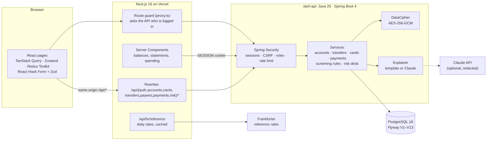
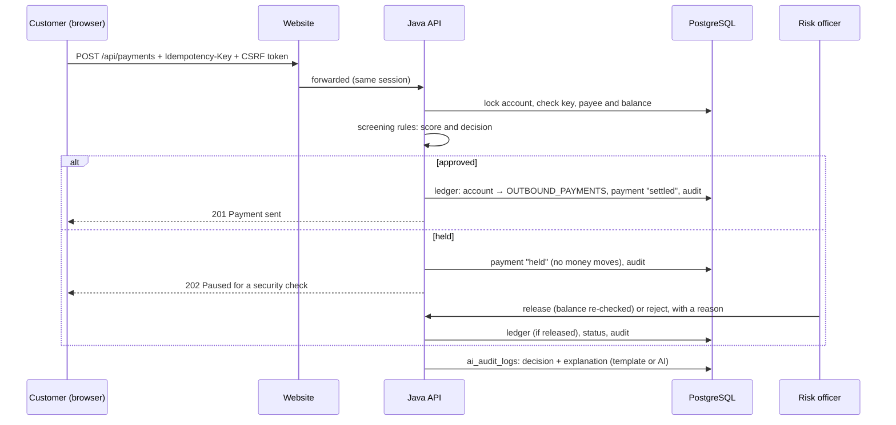

# Sterl architecture

Sterl has three parts: personal banking, a staff-only Credit Risk desk, and an FX desk. All data is invented
([ADR-002](adr/002-fake-data-only.md)); all money is integer pence ([ADR-001](adr/001-integer-pence.md)).

## System

- The browser only calls the website's own address; the website forwards banking calls to the API
  ([ADR-003](adr/003-java-api-behind-nextjs.md)), so the session cookie is first-party and HttpOnly.
- The API is the only component that reads or changes customer data; every customer query is scoped to the
  logged-in customer ([ADR-005](adr/005-session-login-and-roles.md)).

## Database (Flyway)

| Migration | What it adds |
| --- | --- |
| V1 | customers, accounts (incl. the bank's internal accounts), payees, double-entry ledger with balance-at-commit and append-only triggers, audit log, `account_balances` and `account_statement` (window function) views |
| V2 | seed: the sample customer's 90 days of history |
| V3 | idempotency records for exactly-once transfers |
| V4, V5 | logins (Argon2id), roles, Spring Session tables; seed: test customers |
| V6, V7 | cards; seed: sample cards (test numbers, last 4 digits only) |
| V8 | Add money (`top_up` ledger kind) |
| V9 (Java) | encrypts existing names and card details; plain columns dropped |
| V10 | seed: the risk officer (staff) login |
| V11, V12 | the lending book: counterparties, facilities, drawdowns ([ADR-004](adr/004-exposure-and-utilisation.md)); seed: 500 companies |
| V13 | payments to payees, screening results, `ai_audit_logs` ([ADR-006](adr/006-rules-decide-ai-explains.md)) |

## A payment, end to end

## Deployment

- **Website:** Vercel, deployed from `main` (https://sterl-bank.vercel.app). Needs `STERL_API_URL`.
- **API + database:** a container host plus managed PostgreSQL, with secrets in the host's settings only:
  `STERL_DB_URL`, `STERL_DB_USER`, `STERL_DB_PASSWORD`, `STERL_DATA_KEY`. Migrations run when the API starts.
- **CI:** GitHub Actions on every pull request (website: lint, typecheck, tests, build; API: seed check and
  `mvn verify` against PostgreSQL 18), plus CodeQL and Dependabot.
