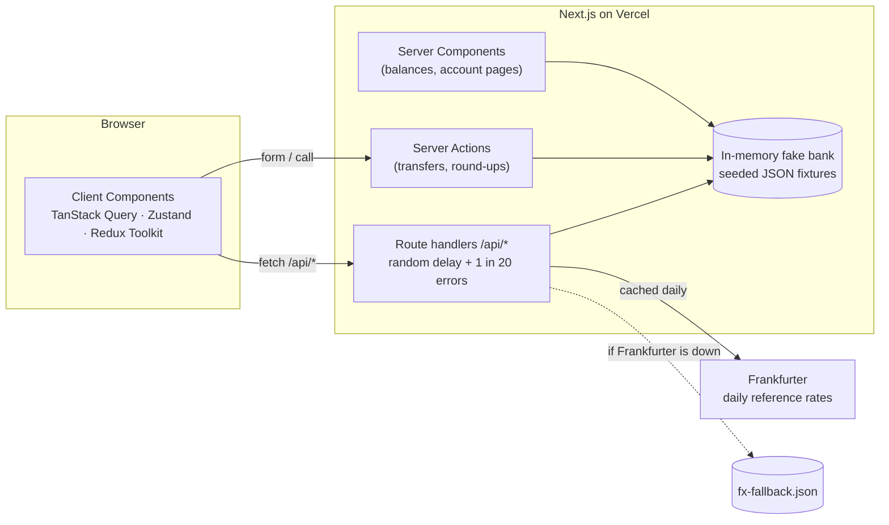
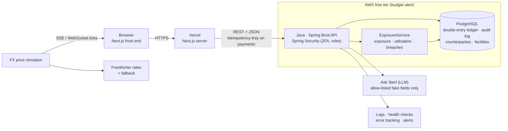

# Sterl architecture

Sterl is a demo bank with three parts: personal banking, a Credit Risk desk and an FX desk.
All data is fake (see [ADR-002](adr/002-fake-data-only.md)); all money is integer pence
(see [ADR-001](adr/001-integer-pence.md)).

## Now: week 1 (v0.1)

Everything runs inside one Next.js app. Route handlers play the part of the bank's API.

- **Server Components** read data on the server and send finished HTML (no JavaScript for them).
- **Client Components** handle anything interactive. Server data goes through TanStack Query
  (caching, retries, optimistic updates); UI state is in Zustand; FX desk state is in Redux Toolkit.
- **Server Actions** change data (transfers with idempotency keys, the round-ups switch).
- Known limit: the in-memory bank resets on restart, and separate server instances on Vercel
  don't share it. The Java API with PostgreSQL (week 2) replaces it.

## Target: v1.0 (end of week 4)

| Part | Responsibility |
| --- | --- |
| Next.js front end | Screens, forms (React Hook Form + Zod), AG Grid, charts, accessibility |
| Java API | All money movement and risk maths; validation (Bean Validation); security |
| PostgreSQL | Source of truth: ledger entries that always sum to zero, audit log, risk data, SQL reports |
| FX simulator | Random walk around the daily reference rate, batched into the grid |
| CI (GitHub Actions) | Lint, typecheck, tests, build for the front end and the Java API on every pull request |
